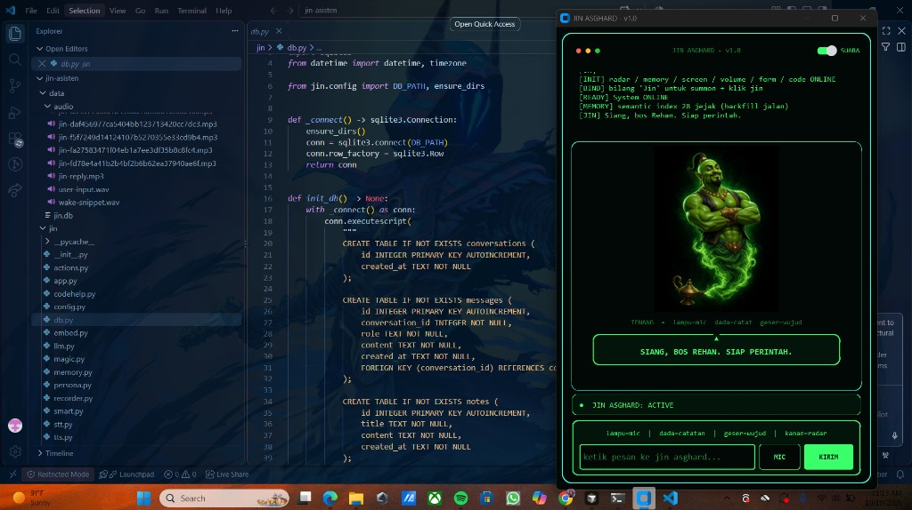

<p align="center">
  
</p>

<h1 align="center">Jin Asghard</h1>

<p align="center">
  Asisten laptop lokal untuk Windows. Dengan mendengarkan perintah suara lewat mic, JIN bisa melakukan segalanya!
</p>

<p align="center">
  
  
  
</p>

Jin Asghard adalah aplikasi desktop bertema terminal hijau. Karakter jin di tengah jendela berubah saat mendengar, berpikir, dan berbicara. Model bahasa, memori, dan pengenalan suara semuanya lokal. Satu kalimat bisa berisi beberapa perintah, dan Jin menjalankannya berurutan.

## Kemampuan

### Bicara dan dengar

- Ketik pesan lalu **KIRIM**, atau bicara lewat mikrofon.
- Ucapkan **Jin** atau **Asghard** untuk memanggil jendela dan langsung mulai mendengar. Perintah bisa menyusul, misalnya `Jin buka vs code`.
- Jawaban muncul bertahap di gelembung saat Jin masih mengetik, lalu dibacakan dengan suara Indonesia kalau sakelar **SUARA** menyala.
- Notifikasi Windows muncul untuk pengingat, teks yang baru disalin, dan saran istirahat.

### Ingatan

- Menyimpan fakta dengan `ingat: ...`, plus catatan dan pengingat.
- Memori semantik memakai embedding lokal, jadi pertanyaan seperti `proyek yang kemarin?` mencari catatan, fakta, dan obrolan lama, bukan cuma chat yang sedang terbuka.
- Fakta yang terucap dalam obrolan bisa tersimpan sendiri.
- **Radar** merangkum tanggal, wujud aktif, pengingat, catatan terakhir, dan ingatan.
- Jam 07.00, radar pagi menambahkan cuaca dan file yang berubah kemarin.

### Layar, file, dan clipboard

- `baca layar` menjepret jendela yang sedang dipakai (bukan jendela Jin) lalu membaca teksnya dengan Windows OCR.
- `jelaskan layar` atau `kenapa error ini` membiarkan model vision lokal melihat jendela itu dan menjelaskan isinya, termasuk arti pesan error. Kalau model vision belum terpasang, Jin kembali ke OCR.
- `screenshot` menyimpan gambar layar.
- Mencari file di Desktop, Documents, Downloads, dan folder project, lalu membaca teks, PDF, dan Word.
- `ringkas` merangkum PDF, Word, atau halaman yang sedang dibuka.
- Mengawasi clipboard. Teks biasa ditawarkan untuk diringkas, diterjemahkan, atau dicatat. Cuplikan kode dicatat diam-diam tanpa mengganggu.
- `tempel ...` menaruh teks di jendela yang tadi aktif.

### Laptop

- Membuka aplikasi, folder, path, atau URL. Nama seperti Chrome, Notepad, dan Desktop dikenali.
- Mengatur volume: naik, turun, atau mute.
- Mengunci laptop.
- Mencari di web, dan bisa langsung membuka hasilnya di browser.
- Mengingatkan istirahat setelah sekitar 50 menit berada di kode.

### Ngoding

- Membuka VS Code di folder yang disebut, atau di project yang terakhir dikerjakan.
- Membuat folder project baru lalu membukanya di editor.
- `lanjut kemarin` membuka project, menampilkan status git, memasang dependensi yang belum ada (`npm install` atau `pip install -r requirements.txt`), lalu membuka terminal di folder itu.
- Mengingat jejak project dan menampilkannya lewat `daftar project`.
- Memasang library dengan pip, npm, yarn, atau pnpm.
- `draft commit` meringkas diff menjadi pesan commit. `commit` memakai pesan itu, `commit pesan: ...` memakai pesan sendiri, dan `commit dan push` mengirimnya ke remote.
- Saat commit, file sensitif seperti `.env` dan kunci privat dikeluarkan dari staging.

### Wujud dan gerakan di karakter

Tiga wujud mengubah gaya bicara: **tenang**, **nyentrik**, dan **serius**. Ganti lewat `mode serius`, atau geser gambar jin ke kiri/kanan.

| Gerakan | Hasil |
| --- | --- |
| Klik lampu | Mulai atau hentikan mikrofon |
| Klik dada | Catatan cepat dari clipboard, atau ketik catatan baru |
| Geser kiri/kanan | Ganti wujud |
| Klik kanan | Radar harian |

Tiga mantra singkat:

- `fokus` — wujud serius, volume turun, lalu radar.
- `lanjut` atau `kerja` — wujud serius, lalu lanjutkan sesi coding.
- `pulang` — pamit, lalu mengunci laptop.

## Stack

| Bagian | Teknologi |
| --- | --- |
| Antarmuka | CustomTkinter |
| Model bahasa | Ollama `qwen2.5:7b` |
| Memori | SQLite + `nomic-embed-text` |
| Dengar | Whisper `tiny` |
| Bicara | edge-tts, suara Indonesia |
| Baca layar | Windows OCR |
| Pahami layar | Ollama `qwen2.5vl:3b` (opsional) |
| Tray | pystray |
| Paket `.exe` | PyInstaller + Inno Setup |

## Menjalankan

1. Pasang [Ollama](https://ollama.com/download) dan pastikan `ollama` ada di PATH.
2. Pasang Python 3.11 atau lebih baru.
3. Double-click `start.bat`.

Pertama kali, skrip mengunduh model (sekitar 4–5 GB), membuat virtual environment, memasang dependensi, lalu membuka aplikasi.

Manual:

```bat
ollama pull qwen2.5:7b
ollama pull nomic-embed-text
python -m venv .venv
.venv\Scripts\activate
pip install -r requirements.txt
copy .env.example .env
python main.py
```

Untuk `jelaskan layar`, pasang model vision sekali: `ollama pull qwen2.5vl:3b` (sekitar 3 GB).

### Aplikasi `.exe`

Jalankan `build.bat`. Hasilnya `dist\JinAsghard\JinAsghard.exe`. Kalau [Inno Setup 6](https://jrsoftware.org/isdl.php) terpasang, skrip itu sekalian membuat installer `dist\JinAsghard-Setup-1.0.0.exe`.

Versi `.exe` menyimpan `.env` dan data di folder `userdata` di samping `JinAsghard.exe`, terpisah dari folder project ini. Installer menawarkan `D:\JinAsghard` kalau drive D ada.

Model Ollama dan Whisper ikut variabel `OLLAMA_MODELS` dan `HF_HOME`. Arahkan keduanya ke drive lain kalau C penuh.

### Tray dan pengaturan

- Tombol **⚙** membuka Pengaturan: nama, model, suara, kata panggil, folder project, pantau clipboard, sembunyi ke tray, dan jalan otomatis saat Windows menyala.
- Tombol tutup menyembunyikan Jin ke tray. Klik kanan ikon tray untuk **Keluar**.

## Contoh perintah

```text
Jin buka vs code
radar
ingat: proyek portofolio pakai React
baca layar
jelaskan layar
kenapa error ini
cari file catatan
baca D:\folder\dokumen.pdf
ringkas
terjemah
volume naik
mode serius
tempel Halo dari Jin Asghard
kunci laptop
fokus
lanjut kemarin
daftar project
install library requests
draft commit
commit dan push
```

## Konfigurasi

Salin `.env.example` menjadi `.env`. File itu tidak ikut di-commit.

| Variabel | Fungsi |
| --- | --- |
| `OLLAMA_MODEL` | Model chat lokal |
| `JIN_VISION_MODEL` | Model vision untuk `jelaskan layar` |
| `JIN_CLIPBOARD` | `0` mematikan tawaran saat menyalin teks |
| `JIN_TRAY` | `0` membuat tombol tutup benar-benar keluar |
| `JIN_EMBED_MODEL` | Model memori semantik |
| `WHISPER_MODEL` | Model pengenalan suara |
| `OWNER_NAME` / `OWNER_CALL` | Nama dan sapaan pemilik |
| `JIN_VOICE` | Suara edge-tts |
| `JIN_WAKE_WORDS` | Kata pemanggil, dipisah koma |
| `JIN_PROJECTS_DIR` | Folder project yang dipindai |

## Privasi

Obrolan, catatan, dan embedding tersimpan di `data/jin.db` pada laptop. Folder `data/`, `.venv/`, dan `.env` diabaikan git.
